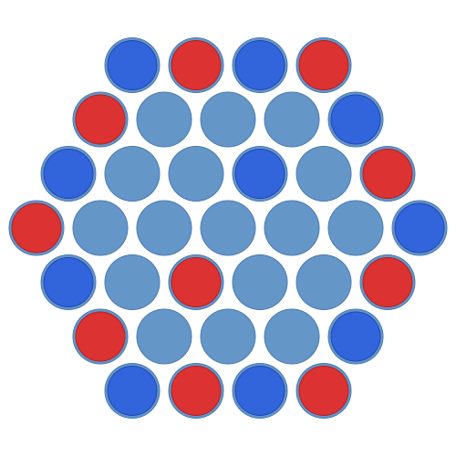
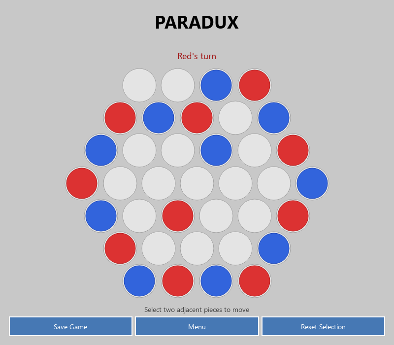
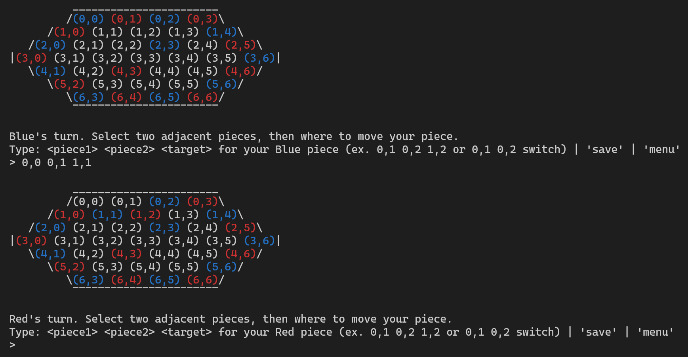

# Paradux

[](https://github.com/haseebn19/paradux/actions/workflows/ci.yml)



A strategic two-player board game where the objective is to align four of your tokens in a row on a hexagonal grid.

## Screenshots





## Features

- **Terminal & GUI Modes**: Play in the console or through a PyQt5 window
- **Hexagonal Board Logic**: Movement system enforcing adjacency and parallel motion
- **Save & Load System**: Store and restore game state using JSON files
- **Rule Enforcement**: Validation of piece swapping, shifting, and boundary constraints
- **MVP Architecture**: Separation between core game state (Model), user interface components (Passive Views), and user input and coordination logic (Presenter)

## Prerequisites

- Python 3.11+
- PyQt5

## Installation

```bash
git clone https://github.com/haseebn19/paradux.git
cd paradux

# Create virtual environment
python -m venv .venv

# Activate virtual environment
# On Windows:
.venv\Scripts\activate
# On macOS/Linux:
source .venv/bin/activate

# Install the package
pip install .
```

## Usage

```bash
paradux
```

`python -m paradux` does the same. The game opens a window and a terminal interface at the same time; a move made in either one appears in both. Saved games are stored in a `saves` folder in the directory you start the game from.

1. Select **New Game** from the main menu. The first player is chosen at random.
2. Select one of your pieces and an adjacent opponent piece.
3. Select where to move them. Both pieces move one space in the same direction.
4. To swap the two pieces instead, click **Switch Pieces**. Press **Esc** to start the selection over.

You cannot undo your opponent's last move. In the terminal, type the two pieces and where your piece goes, for example `0,1 0,0 1,2`, or end with `switch` to swap them.

## Development

### Setup

```bash
# Create and activate virtual environment
python -m venv .venv
# On Windows:
.venv\Scripts\activate
# On macOS/Linux:
source .venv/bin/activate

# Install in editable mode with dev dependencies
pip install -e ".[dev]"
```

### Testing

```bash
pytest
```

With coverage:

```bash
pytest --cov --cov-report=term-missing
```

### Linting

```bash
ruff check .
ruff format --check .
```

## Building

```bash
pip install build
python -m build
```

Output location: `dist/`

## Project Structure

```text
paradux/
+-- src/paradux/
|   +-- assets/               Logo
|   +-- __main__.py           Entry point; starts the window and the terminal interface
|   +-- interfaces.py         Enums, constants, and the GameView protocol
|   +-- model.py              Board state, move validation, and win detection
|   +-- controller.py         Presenter and terminal input loop
|   +-- gui_view.py           PyQt5 window
|   +-- view.py               Terminal rendering
|   +-- save_load_manager.py  JSON save files
+-- docs/                     Screenshots
+-- tests/                    pytest suite
+-- pyproject.toml            Package, Ruff, and pytest configuration
```

## Credits

### Development Team
- Haseeb Niazi
- Nathan Starkman
- Gail Mathew
- Dana Kleber

### Third-Party Libraries
- [PyQt5](https://pypi.org/project/PyQt5/) - GUI rendering and event loop
- [pytest](https://docs.pytest.org/) - Testing framework
- [ruff](https://docs.astral.sh/ruff/) - Python linting and formatting

## License

This project is licensed under the [MIT License](LICENSE).

---

*Originally developed for CIS\*3260 at the University of Guelph.*
